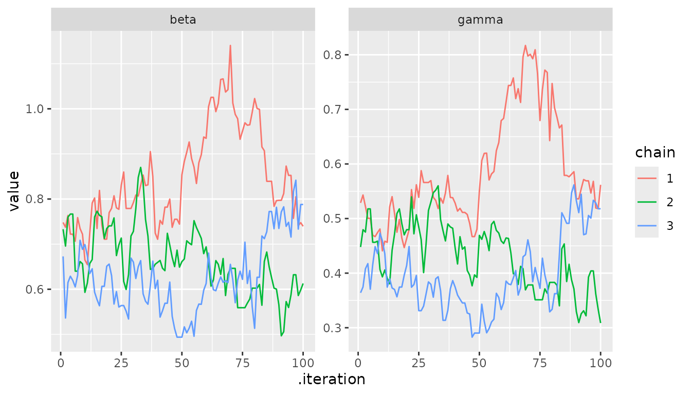
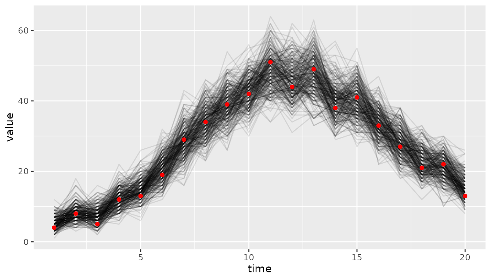
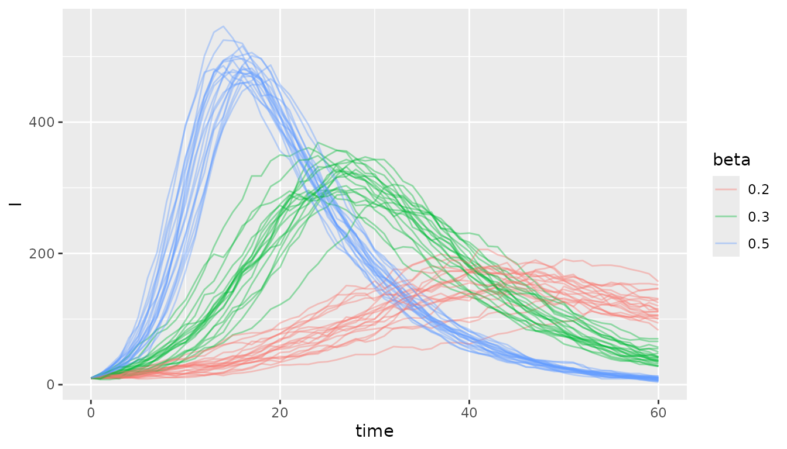
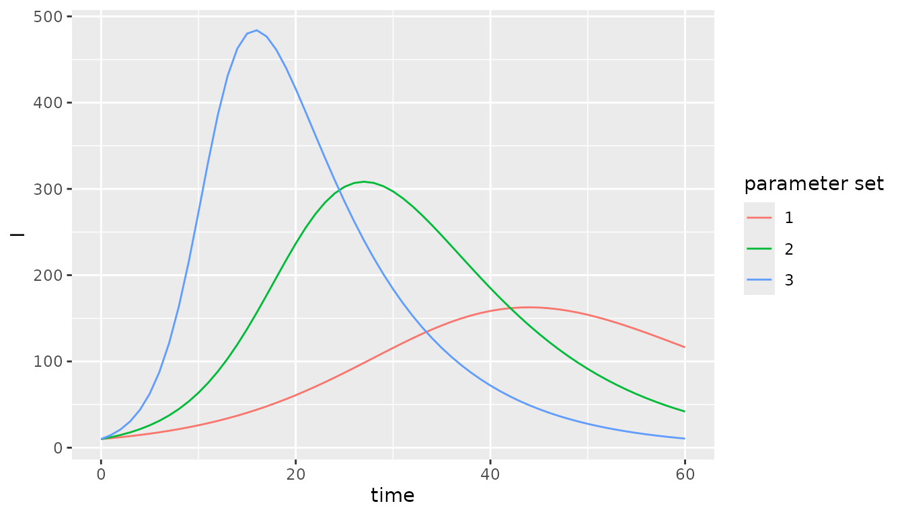
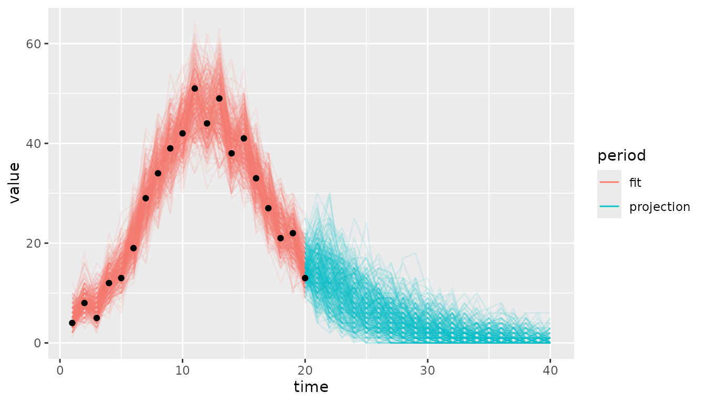
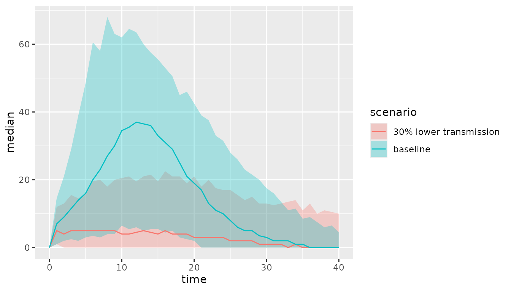

# Tidy output from odin2, dust2 and monty

`dust2` returns model output as arrays, with state on the first
dimension and time on the last, and `monty` stores samples and
trajectories the same way. This package turns those arrays into
long-format tibbles, with one row per value, that can go straight into
`ggplot2`.

``` r

library(tidyodin)
library(odin2)
library(dust2)
library(monty)
library(ggplot2)
```

## A simulation

A stochastic SIR model that also tracks daily incidence, and can be
compared to case data:

``` r

sir <- odin({
  update(S) <- S - n_SI
  update(I) <- I + n_SI - n_IR
  update(R) <- R + n_IR
  update(incidence) <- incidence + n_SI
  p_SI <- 1 - exp(-beta * I / N * dt)
  p_IR <- 1 - exp(-gamma * dt)
  n_SI <- Binomial(S, p_SI)
  n_IR <- Binomial(I, p_IR)
  initial(S) <- N - I0
  initial(I) <- I0
  initial(R) <- 0
  initial(incidence, zero_every = 1) <- 0
  N <- parameter(1000)
  I0 <- parameter(10)
  beta <- parameter(0.4)
  gamma <- parameter(0.1)
  cases <- data()
  cases ~ Poisson(incidence)
}, quiet = TRUE)
```

Run 30 particles and tidy the result.
[`tidy_simulation()`](https://mrc-ide.github.io/tidyodin/reference/tidy_simulation.md)
needs the system and the times as well as the output, because the array
does not record either:

``` r

sys <- dust_system_create(sir, list(), n_particles = 30, dt = 0.25)
dust_system_set_state_initial(sys)
t <- 0:60
y <- dust_system_simulate(sys, t)
dim(y)
#> [1]  4 30 61

sim <- tidy_simulation(y, sys, t)
sim
#> # A tibble: 7,320 × 4
#>    particle  time variable  value
#>       <int> <int> <chr>     <dbl>
#>  1        1     0 S           990
#>  2        1     0 I            10
#>  3        1     0 R             0
#>  4        1     0 incidence     0
#>  5        2     0 S           990
#>  6        2     0 I            10
#>  7        2     0 R             0
#>  8        2     0 incidence     0
#>  9        3     0 S           990
#> 10        3     0 I            10
#> # ℹ 7,310 more rows
```

``` r

ggplot(sim, aes(time, value, group = particle)) +
  geom_line(alpha = 0.3) +
  facet_wrap(~variable, scales = "free_y")
```


[`summarise_trajectories()`](https://mrc-ide.github.io/tidyodin/reference/summarise_trajectories.md)
collapses over particles (and draws and chains, where present) for a
ribbon plot:

``` r

ggplot(summarise_trajectories(sim), aes(time)) +
  geom_ribbon(aes(ymin = lower, ymax = upper), alpha = 0.3) +
  geom_line(aes(y = median)) +
  facet_wrap(~variable, scales = "free_y")
```


## Array variables

Variables with dimensions get one index column per dimension. `dims`
names those columns and `labels` turns an index into a labelled factor:

``` r

sir_age <- odin({
  update(S[]) <- S[i] - n_SI[i]
  update(I[]) <- I[i] + n_SI[i] - n_IR[i]
  update(R[]) <- R[i] + n_IR[i]
  p_SI <- 1 - exp(-beta * sum(I) / sum(N) * dt)
  p_IR <- 1 - exp(-gamma * dt)
  n_SI[] <- Binomial(S[i], p_SI)
  n_IR[] <- Binomial(I[i], p_IR)
  initial(S[]) <- N[i] - 5
  initial(I[]) <- 5
  initial(R[]) <- 0
  N <- parameter()
  beta <- parameter(0.4)
  gamma <- parameter(0.1)
  n_age <- parameter(2)
  dim(S, I, R, n_SI, n_IR, N) <- n_age
}, quiet = TRUE)

sys <- dust_system_create(sir_age, list(N = c(300, 700)), n_particles = 10)
dust_system_set_state_initial(sys)
y <- dust_system_simulate(sys, t)

sim_age <- tidy_simulation(y, sys, t, dims = "age",
                           labels = list(age = c("children", "adults")))
sim_age
#> # A tibble: 3,660 × 5
#>    particle  time variable age      value
#>       <int> <int> <chr>    <fct>    <dbl>
#>  1        1     0 S        children   295
#>  2        1     0 S        adults     695
#>  3        1     0 I        children     5
#>  4        1     0 I        adults       5
#>  5        1     0 R        children     0
#>  6        1     0 R        adults       0
#>  7        2     0 S        children   295
#>  8        2     0 S        adults     695
#>  9        2     0 I        children     5
#> 10        2     0 I        adults       5
#> # ℹ 3,650 more rows

ggplot(sim_age, aes(time, value, colour = age,
                    group = interaction(age, particle))) +
  geom_line(alpha = 0.4) +
  facet_wrap(~variable)
```


## A fit

Fit the SIR model to some case data with a particle filter, saving the
trajectories and the final state of each sample:

``` r

data <- data.frame(
  time = 1:20,
  cases = c(4, 8, 5, 12, 13, 19, 29, 34, 39, 42, 51, 44, 49, 38, 41, 33, 27,
            21, 22, 13))
filter <- dust_filter_create(sir, time_start = 0, data = data,
                             n_particles = 100, dt = 0.25)
packer <- monty_packer(c("beta", "gamma"), fixed = list(N = 1000, I0 = 10))
likelihood <- dust_likelihood_monty(filter, packer, save_trajectories = TRUE,
                                    save_state = TRUE)
prior <- monty_dsl({
  beta ~ Exponential(mean = 0.5)
  gamma ~ Exponential(mean = 0.2)
})
sampler <- monty_sampler_random_walk(diag(c(0.002, 0.001)))
samples <- monty_sample(likelihood + prior, sampler, 600,
                        initial = c(0.4, 0.1), n_chains = 3)
#> ⡀⠀ Sampling [▁▁▁] ■                                |   0% ETA: 14s
#> ⠄⠀ Sampling [█▃▁] ■■■■■■■■■■■■■■■                  |  46% ETA:  2s
#> ✔ Sampled 1800 steps across 3 chains in 2.8s
#> 
samples <- monty_samples_thin(samples, burnin = 300, thinning_factor = 3)
```

Parameters, with chain and iteration recorded for trace plots:

``` r

pars <- tidy_pars(samples)
pars
#> # A tibble: 600 × 5
#>    .chain .iteration .draw parameter value
#>     <int>      <int> <int> <chr>     <dbl>
#>  1      1          1     1 beta      0.748
#>  2      1          1     1 gamma     0.529
#>  3      1          2     2 beta      0.737
#>  4      1          2     2 gamma     0.543
#>  5      1          3     3 beta      0.764
#>  6      1          3     3 gamma     0.522
#>  7      1          4     4 beta      0.722
#>  8      1          4     4 gamma     0.500
#>  9      1          5     5 beta      0.722
#> 10      1          5     5 gamma     0.500
#> # ℹ 590 more rows

ggplot(pars, aes(.iteration, value, colour = factor(.chain))) +
  geom_line() +
  facet_wrap(~parameter, scales = "free_y") +
  labs(colour = "chain")
```



The fitted trajectories need the filter too, as the samples do not
record the names of the state variables or the times:

``` r

fit <- tidy_trajectories(samples, filter, vars = "incidence")
fit
#> # A tibble: 6,000 × 6
#>    .chain .iteration .draw  time variable  value
#>     <int>      <int> <int> <int> <chr>     <dbl>
#>  1      1          1     1     1 incidence     6
#>  2      1          1     1     2 incidence    12
#>  3      1          1     1     3 incidence     8
#>  4      1          1     1     4 incidence    22
#>  5      1          1     1     5 incidence    14
#>  6      1          1     1     6 incidence    16
#>  7      1          1     1     7 incidence    29
#>  8      1          1     1     8 incidence    30
#>  9      1          1     1     9 incidence    40
#> 10      1          1     1    10 incidence    40
#> # ℹ 5,990 more rows

ggplot(fit, aes(time, value)) +
  geom_line(aes(group = .draw), alpha = 0.1) +
  geom_point(aes(y = cases), data = data, colour = "red")
```



## Running the model over many parameter sets

[`run_parameter_sets()`](https://mrc-ide.github.io/tidyodin/reference/run_parameter_sets.md)
runs the model from its initial conditions, once per parameter set, and
returns an object with the same structure as `samples`. The parameter
sets can be a data frame with one row per set. Parameters that should
stay the same in every set go in `fixed`:

``` r

grid <- data.frame(beta = c(0.2, 0.3, 0.5))
sweep <- run_parameter_sets(sir, grid, times = 0:60,
                            fixed = list(gamma = 0.1, N = 1000),
                            n_particles = 20, dt = 0.25)
sweep
#> 
#> ── <monty_samples: 1 parameter x 3 samples x 1 chain> ──────────────────────────
#> ℹ Parameters: 'beta'
#> ℹ Conversion to other types is possible:
#> → ! posterior::as_draws_array() [package installed, but not loaded]
#> → ! posterior::as_draws_df() [package installed, but not loaded]
#> → ✖ coda::as.mcmc.list() [package missing]
#> ℹ These samples have associated observations
#> ℹ See `?monty_sample()` and `vignette("samples")` for more information
```

Because the structure matches a fit, the same functions tidy it. Each
parameter set is a draw, so parameters join to trajectories by `.draw`:

``` r

sweep_tidy <- dplyr::left_join(
  tidy_trajectories(sweep, vars = "I"),
  dplyr::select(tidy_pars(sweep), .draw, beta = value),
  by = ".draw")

ggplot(sweep_tidy, aes(time, value, group = interaction(.draw, particle),
                       colour = factor(beta))) +
  geom_line(alpha = 0.4) +
  labs(colour = "beta", y = "I")
```



`n_particles` sets the number of stochastic realisations per parameter
set. With `deterministic = TRUE` a stochastic model is instead run once
per set using expectations in place of random draws:

``` r

sweep_det <- run_parameter_sets(sir, grid, times = 0:60,
                                fixed = list(gamma = 0.1, N = 1000),
                                deterministic = TRUE, dt = 0.25)

ggplot(tidy_trajectories(sweep_det, vars = "I"),
       aes(time, value, colour = factor(.draw))) +
  geom_line() +
  labs(colour = "parameter set", y = "I")
```



## Continuing from a fit

[`continue_parameter_sets()`](https://mrc-ide.github.io/tidyodin/reference/continue_parameter_sets.md)
carries on from the final state and time of a set of samples, with each
sample continuing from its own state using its own parameters. For a fit
this needs the filter and the packer, and the likelihood must have been
created with `save_state = TRUE`. Here each posterior draw is projected
forward 20 days:

``` r

projection <- continue_parameter_sets(samples, times = 20:40, obj = filter,
                                      packer = packer)

both <- dplyr::bind_rows(
  fit = fit,
  projection = tidy_trajectories(projection, vars = "incidence"),
  .id = "period")

ggplot(both, aes(time, value)) +
  geom_line(aes(group = interaction(.draw, period), colour = period),
            alpha = 0.1) +
  geom_point(aes(y = cases), data = data) +
  guides(colour = guide_legend(override.aes = list(alpha = 1)))
```



The result of either function can itself be continued, and `n_particles`
runs several realisations forward from each draw’s state.

## Counterfactuals

Posterior samples can also be passed to
[`run_parameter_sets()`](https://mrc-ide.github.io/tidyodin/reference/run_parameter_sets.md)
to rerun the model from the start. `modify` changes each parameter set
before it is run. Running the baseline the same way gives a
like-for-like comparison, since both are then unfiltered simulations:

``` r

baseline <- run_parameter_sets(sir, samples, times = 0:40, packer = packer,
                               dt = 0.25)
reduced <- run_parameter_sets(sir, samples, times = 0:40, packer = packer,
                              modify = function(p) {
                                p$beta <- p$beta * 0.7
                                p
                              }, dt = 0.25)
scenarios <- dplyr::bind_rows(
  baseline = tidy_trajectories(baseline, vars = "incidence"),
  "30% lower transmission" = tidy_trajectories(reduced, vars = "incidence"),
  .id = "scenario")

ggplot(summarise_trajectories(scenarios), aes(time, fill = scenario)) +
  geom_ribbon(aes(ymin = lower, ymax = upper), alpha = 0.3) +
  geom_line(aes(y = median, colour = scenario))
```


