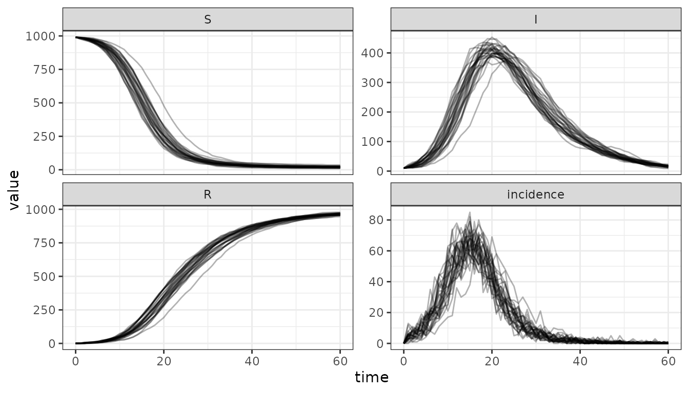
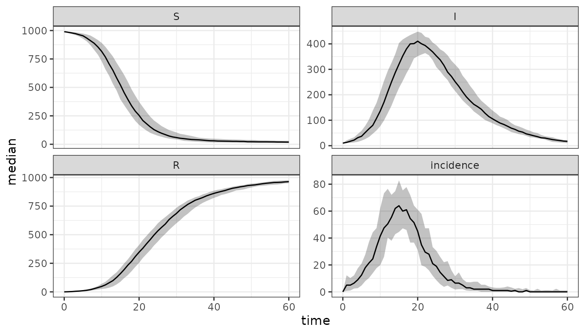
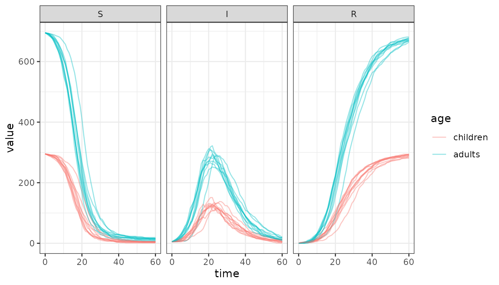

# Tidy output from odin2, dust2 and monty

`dust2` returns model output as arrays, with state on the first
dimension and time on the last, and `monty` stores samples and
trajectories the same way. This package turns those arrays into
long-format tibbles, with one row per value, that can go straight into
`ggplot2`.

``` r

library(tidyodin)
library(odin2)
library(dust2)
library(monty)
library(ggplot2)
theme_set(theme_bw())
```

## A simulation

A stochastic SIR model that also tracks daily incidence, and can be
compared to case data:

``` r

sir <- odin({
  update(S) <- S - n_SI
  update(I) <- I + n_SI - n_IR
  update(R) <- R + n_IR
  update(incidence) <- incidence + n_SI
  p_SI <- 1 - exp(-beta * I / N * dt)
  p_IR <- 1 - exp(-gamma * dt)
  n_SI <- Binomial(S, p_SI)
  n_IR <- Binomial(I, p_IR)
  initial(S) <- N - I0
  initial(I) <- I0
  initial(R) <- 0
  initial(incidence, zero_every = 1) <- 0
  N <- parameter(1000)
  I0 <- parameter(10)
  beta <- parameter(0.4)
  gamma <- parameter(0.1)
  cases <- data()
  cases ~ Poisson(incidence)
}, quiet = TRUE)
```

Run 30 particles and tidy the result.
[`tidy_simulation()`](https://mrc-ide.github.io/tidyodin/reference/tidy_simulation.md)
needs the system and the times as well as the output, because the array
does not record either:

``` r

sys <- dust_system_create(sir, list(), n_particles = 30, dt = 0.25)
dust_system_set_state_initial(sys)
t <- 0:60
y <- dust_system_simulate(sys, t)
dim(y)
#> [1]  4 30 61

sim <- tidy_simulation(y, sys, t)
sim
#> # A tibble: 7,320 × 4
#>    particle  time variable  value
#>       <int> <int> <fct>     <dbl>
#>  1        1     0 S           990
#>  2        1     0 I            10
#>  3        1     0 R             0
#>  4        1     0 incidence     0
#>  5        2     0 S           990
#>  6        2     0 I            10
#>  7        2     0 R             0
#>  8        2     0 incidence     0
#>  9        3     0 S           990
#> 10        3     0 I            10
#> # ℹ 7,310 more rows
```

``` r

ggplot(sim, aes(time, value, group = particle)) +
  geom_line(alpha = 0.3) +
  facet_wrap(~variable, scales = "free_y")
```



[`summarise_trajectories()`](https://mrc-ide.github.io/tidyodin/reference/summarise_trajectories.md)
collapses over particles (and draws and chains, where present) for a
ribbon plot:

``` r

ggplot(summarise_trajectories(sim), aes(time)) +
  geom_ribbon(aes(ymin = lower, ymax = upper), alpha = 0.3) +
  geom_line(aes(y = median)) +
  facet_wrap(~variable, scales = "free_y")
```



## Array variables

Variables with dimensions get one index column per dimension. `dims`
names those columns and `labels` turns an index into a labelled factor:

``` r

sir_age <- odin({
  update(S[]) <- S[i] - n_SI[i]
  update(I[]) <- I[i] + n_SI[i] - n_IR[i]
  update(R[]) <- R[i] + n_IR[i]
  p_SI <- 1 - exp(-beta * sum(I) / sum(N) * dt)
  p_IR <- 1 - exp(-gamma * dt)
  n_SI[] <- Binomial(S[i], p_SI)
  n_IR[] <- Binomial(I[i], p_IR)
  initial(S[]) <- N[i] - 5
  initial(I[]) <- 5
  initial(R[]) <- 0
  N <- parameter()
  beta <- parameter(0.4)
  gamma <- parameter(0.1)
  n_age <- parameter(2)
  dim(S, I, R, n_SI, n_IR, N) <- n_age
}, quiet = TRUE)

sys <- dust_system_create(sir_age, list(N = c(300, 700)), n_particles = 10)
dust_system_set_state_initial(sys)
y <- dust_system_simulate(sys, t)

sim_age <- tidy_simulation(y, sys, t, dims = "age",
                           labels = list(age = c("children", "adults")))
sim_age
#> # A tibble: 3,660 × 5
#>    particle  time variable age      value
#>       <int> <int> <fct>    <fct>    <dbl>
#>  1        1     0 S        children   295
#>  2        1     0 S        adults     695
#>  3        1     0 I        children     5
#>  4        1     0 I        adults       5
#>  5        1     0 R        children     0
#>  6        1     0 R        adults       0
#>  7        2     0 S        children   295
#>  8        2     0 S        adults     695
#>  9        2     0 I        children     5
#> 10        2     0 I        adults       5
#> # ℹ 3,650 more rows

ggplot(sim_age, aes(time, value, colour = age,
                    group = interaction(age, particle))) +
  geom_line(alpha = 0.4) +
  facet_wrap(~variable)
```



## A fit

Fit the SIR model to some case data with a particle filter, saving the
trajectories and the final state of each sample:

``` r

data <- data.frame(
  time = 1:20,
  cases = c(4, 8, 5, 12, 13, 19, 29, 34, 39, 42, 51, 44, 49, 38, 41, 33, 27,
            21, 22, 13))
filter <- dust_filter_create(sir, time_start = 0, data = data,
                             n_particles = 100, dt = 0.25)
packer <- monty_packer(c("beta", "gamma"), fixed = list(N = 1000, I0 = 10))
likelihood <- dust_likelihood_monty(filter, packer, save_trajectories = TRUE,
                                    save_state = TRUE)
prior <- monty_dsl({
  beta ~ Exponential(mean = 0.5)
  gamma ~ Exponential(mean = 0.2)
})
```

In this model `beta` and `gamma` are strongly correlated in the
posterior, so the random walk proposal is given a matching covariance
(taken from a short pilot run) to help the chains mix:

``` r

vcv <- matrix(c(0.051, 0.040, 0.040, 0.035), 2, 2)
sampler <- monty_sampler_random_walk(vcv)
samples <- monty_sample(likelihood + prior, sampler, 3000,
                        initial = c(0.7, 0.45), n_chains = 3)
#> ⡀⠀ Sampling [▁▁▁] ■                                |   0% ETA:  1m
#> ⠄⠀ Sampling [▅▁▁] ■■■■■■■                          |  20% ETA: 11s
#> ⢂⠀ Sampling [█▂▁] ■■■■■■■■■■■■■                    |  41% ETA:  8s
#> ⡂⠀ Sampling [█▇▁] ■■■■■■■■■■■■■■■■■■■■             |  64% ETA:  5s
#> ⠅⠀ Sampling [██▅] ■■■■■■■■■■■■■■■■■■■■■■■■■■■      |  86% ETA:  2s
#> ✔ Sampled 9000 steps across 3 chains in 13.4s
#> 
samples <- monty_samples_thin(samples, burnin = 1000, thinning_factor = 5)
```

Parameters, with chain and iteration recorded for trace plots:

``` r

pars <- tidy_pars(samples)
pars
#> # A tibble: 2,400 × 5
#>    .chain .iteration .draw parameter value
#>     <int>      <int> <int> <fct>     <dbl>
#>  1      1          1     1 beta      0.675
#>  2      1          1     1 gamma     0.441
#>  3      1          2     2 beta      0.675
#>  4      1          2     2 gamma     0.441
#>  5      1          3     3 beta      1.08 
#>  6      1          3     3 gamma     0.818
#>  7      1          4     4 beta      0.558
#>  8      1          4     4 gamma     0.348
#>  9      1          5     5 beta      0.558
#> 10      1          5     5 gamma     0.348
#> # ℹ 2,390 more rows

ggplot(pars, aes(.iteration, value, colour = factor(.chain))) +
  geom_line() +
  facet_wrap(~parameter, scales = "free_y") +
  labs(colour = "chain")
```


The fitted trajectories need the filter too, as the samples do not
record the names of the state variables or the times:

``` r

fit <- tidy_trajectories(samples, filter, vars = "incidence")
fit
#> # A tibble: 24,000 × 6
#>    .chain .iteration .draw  time variable  value
#>     <int>      <int> <int> <int> <fct>     <dbl>
#>  1      1          1     1     1 incidence     8
#>  2      1          1     1     2 incidence     7
#>  3      1          1     1     3 incidence     7
#>  4      1          1     1     4 incidence    13
#>  5      1          1     1     5 incidence    13
#>  6      1          1     1     6 incidence    19
#>  7      1          1     1     7 incidence    31
#>  8      1          1     1     8 incidence    40
#>  9      1          1     1     9 incidence    40
#> 10      1          1     1    10 incidence    37
#> # ℹ 23,990 more rows

ggplot(fit, aes(time, value)) +
  geom_line(aes(group = .draw), alpha = 0.03) +
  geom_point(aes(y = cases), data = data, colour = "red")
```


## Next steps

[`vignette("parameter-sets")`](https://mrc-ide.github.io/tidyodin/articles/parameter-sets.md)
shows how to run a model over many parameter sets, for sensitivity
analyses, projections from a fit and counterfactuals, with output in
this same format.
